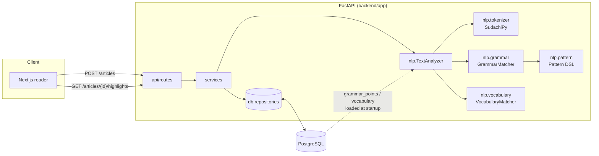

# Japanese Immersion Reading & JLPT Grammar Parser

> Pre-computed NLP that finds **JLPT grammar points (文法) and vocabulary (N5–N1)** in unsegmented Japanese text and returns exact character spans that a reading UI can highlight.

   

---

## 1. The problem

Japanese is written without spaces, and grammar is expressed through **multi-morpheme constructions** spread across conjugated words:

```
宿題を出さなければならない。
         └──────────────┘  〜なければならない (N4, "must")
```

Learners doing *immersion reading* (news, novels, blogs) constantly hit constructions like this without knowing which JLPT level they belong to or what they mean in context. A plain substring search fails, for three reasons:

- **Conjugation changes the surface form.** 読**んで**いる and 食べ**て**いる are the same 〜ている.
- **Word boundaries are ambiguous.** A naive search for `ばかり` cannot tell 〜たばかり ("just did") from the noun-modifying ばかり ("only").
- **Grammar spans several tokens.** These spans can nest: 忘れ**てしまって**いる contains both 〜てしまう and 〜ている.

This project solves it with **morphological analysis (SudachiPy)**, followed by a **declarative token-pattern matcher**. Results are pre-computed once per article and stored as character offsets, so the frontend only has to paint spans.

## 2. Features

- Tokenization with SudachiPy (split mode C, SudachiDict-core). Long articles are chunked transparently around Sudachi's ~49 KB input limit.
- JLPT grammar detection driven by a JSON **Pattern DSL**. Matching uses surface, lemma, POS and conjugation form, plus optional and context elements. Rules live in PostgreSQL, so they can be added without a deploy and hot-reloaded.
- JLPT vocabulary tagging by Sudachi lemma, so conjugated forms map back to the dictionary entry.
- Output fields for each highlight: `start`/`end` offsets, JLPT level, conjugation formula, generic meaning and **contextual meaning**. The contextual meaning is bound to the actual word, e.g. "ongoing action — applied to「読む」".
- Versioned parse runs. Re-parsing after a rule change keeps history, and exactly one run per article is "current", enforced by a partial unique index.
- Difficulty estimate per article, robust to stray outliers.

## 3. Architecture



**Ingest flow (pre-computation)**

1. `POST /api/v1/articles` receives the title and body.
2. `TextAnalyzer.analyze()` runs four steps:
   - Sudachi produces tokens with code-point offsets.
   - `GrammarMatcher` runs every rule pattern at every token position. It takes the longest match, and a rule never overlaps itself.
   - `VocabularyMatcher` looks up each token by lemma.
   - `estimate_level()` estimates the article's difficulty.
3. A single transaction writes `articles`, `parse_runs` (marked current) and `article_highlights` in bulk.
4. Readers call `GET /articles/{id}/highlights`. This is a single indexed query against the `v_current_highlights` view, with no NLP at read time.

**Design decisions**

| Decision | Why |
|---|---|
| `app/nlp` has zero third-party imports (except `tokenizer.py`) | The matcher is unit-tested without Sudachi, FastAPI or a database. |
| Patterns stored as JSONB, parsed by the same code in the API and the seeder | One source of truth. A malformed rule fails at seed time, not in production. |
| `context` elements in patterns | 〜ている must match the verb, but the highlight should cover only ている. |
| Per-thread Sudachi tokenizer | Sudachi tokenizers must not be shared across threads, and FastAPI runs sync endpoints in a thread pool. |
| NLP runs **before** the DB transaction opens | No pooled connection is held during CPU-bound work. |
| Composite FK `(parse_run_id, article_id)` | The database guarantees a highlight's `article_id` matches its run. |
| `CHECK (char_length(surface) = end_index - start_index)` | Catches offset bugs at write time. |

## 4. Tech stack

| Layer | Technology |
|---|---|
| Language | Python 3.10+ |
| API | FastAPI, Pydantic v2, pydantic-settings, Uvicorn |
| NLP | SudachiPy + SudachiDict-core (UniDic-style POS tags) |
| Database | PostgreSQL 14+ (psycopg 3 + psycopg-pool, raw SQL) |
| Frontend (spec) | Next.js, TypeScript, Tailwind ([docs/frontend-spec.md](docs/frontend-spec.md)) |
| Tooling | pytest, ruff, Docker Compose |

## 5. Directory structure

```
japanese-immersion-parser/
├── README.md
├── docker-compose.yml             # PostgreSQL 16 + API
├── database/
│   ├── schema.sql                 # tables, enums, constraints, indexes, view
│   └── seeds/
│       ├── grammar_points.json    # JLPT grammar master + token patterns (N5–N1)
│       └── vocabulary.json        # sample JLPT vocabulary
├── backend/
│   ├── Dockerfile
│   ├── pyproject.toml             # pytest + ruff config
│   ├── requirements.txt / requirements-dev.txt
│   ├── .env.example
│   ├── app/
│   │   ├── main.py                # app factory, lifespan, routers
│   │   ├── schemas.py             # Pydantic request/response contract
│   │   ├── core/config.py         # settings (JIP_* env vars)
│   │   ├── db/
│   │   │   ├── pool.py            # psycopg connection pool
│   │   │   └── repositories.py    # SQL for grammar, vocabulary, articles
│   │   ├── nlp/                   # pure-Python core (testable in isolation)
│   │   │   ├── types.py           # Token, JLPTLevel
│   │   │   ├── tokenizer.py       # SudachiPy adapter + sentence chunking
│   │   │   ├── pattern.py         # Pattern DSL + backtracking matcher
│   │   │   ├── grammar.py         # GrammarRule, GrammarMatcher
│   │   │   ├── vocabulary.py      # VocabularyMatcher
│   │   │   └── analyzer.py        # TextAnalyzer façade, level estimation
│   │   ├── services/
│   │   │   ├── article_service.py # ingest, reparse, read use-cases
│   │   │   └── bootstrap.py       # builds the analyzer from DB master data
│   │   └── api/
│   │       ├── deps.py
│   │       └── routes/            # health, parse, articles, grammar
│   ├── scripts/seed_db.py         # idempotent JSON → PostgreSQL loader
│   └── tests/                     # unit, API-contract and Sudachi integration tests
├── docs/frontend-spec.md          # Next.js reader specification
└── frontend/                      # Next.js app (to be scaffolded)
```

## 6. Getting started

### Option A: Docker Compose

```bash
git clone https://github.com/<you>/japanese-immersion-parser.git
cd japanese-immersion-parser
docker compose up -d --build                         # schema.sql is applied on first start
docker compose run --rm api python -m scripts.seed_db
docker compose restart api                           # reload rules (or POST /api/v1/grammar/reload)
open http://localhost:8000/docs
```

### Option B: Local

```bash
# 1. Database
createdb jip
psql -d jip -f database/schema.sql

# 2. Backend
cd backend
python -m venv .venv && source .venv/bin/activate
pip install -r requirements-dev.txt                  # includes sudachidict_core
cp .env.example .env                                 # edit JIP_DATABASE_URL
python -m scripts.seed_db
uvicorn app.main:app --reload
```

### Tests

```bash
cd backend
pytest              # unit tests run anywhere; Sudachi/API tests auto-skip if deps are missing
ruff check .
```

`tests/test_sudachi_integration.py` checks the seed patterns against the **real** Sudachi dictionary. Run it after upgrading `sudachidict_core`, because tokenization can shift between dictionary releases.

## 7. API

| Method | Path | Description |
|---|---|---|
| `GET`  | `/health` | DB status, tokenizer info, rule counts |
| `POST` | `/api/v1/parse` | Analyse text on the fly (not stored) |
| `POST` | `/api/v1/articles` | Store an article and pre-compute its highlights |
| `GET`  | `/api/v1/articles` | List articles (`limit`, `offset`) |
| `GET`  | `/api/v1/articles/{id}` | Article with body |
| `GET`  | `/api/v1/articles/{id}/highlights` | Pre-computed highlights (`?level=N3&level=N2&kind=grammar`) |
| `POST` | `/api/v1/articles/{id}/reparse` | Re-run analysis with the current rules |
| `GET`  | `/api/v1/grammar` | JLPT grammar master (`?level=N4`) |
| `POST` | `/api/v1/grammar/reload` | Hot-reload rules and vocabulary (protect in production) |

### Example

```bash
curl -s localhost:8000/api/v1/parse \
  -H 'Content-Type: application/json' \
  -d '{"text": "財布を忘れてしまった。", "include_vocabulary": true}'
```

```jsonc
{
  "text_length": 11,
  "token_count": 7,
  "estimated_level": "N4",
  "level_counts": {"N5": 1, "N4": 2, "N3": 0, "N2": 0, "N1": 0},
  "highlights": [
    { "kind": "vocabulary", "jlpt_level": "N4", "start": 0, "end": 2, "surface": "財布",
      "token_start": 0, "token_end": 1, "contextual_meaning": "wallet",
      "vocabulary": {"id": 11, "lemma": "財布", "reading": "サイフ", "meaning_en": "wallet"} },
    { "kind": "vocabulary", "jlpt_level": "N5", "start": 3, "end": 5, "surface": "忘れ",
      "token_start": 2, "token_end": 3, "contextual_meaning": "to forget",
      "vocabulary": {"id": 9, "lemma": "忘れる", "reading": "ワスレル", "meaning_en": "to forget"} },
    { "kind": "grammar", "jlpt_level": "N4", "start": 5, "end": 9, "surface": "てしまっ",
      "token_start": 3, "token_end": 5,
      "contextual_meaning": "do completely; do something regrettable — applied to「忘れる」",
      "grammar": { "id": 10, "slug": "te-shimau", "label": "〜てしまう",
                   "conjugation_formula": "V-て形 + しまう",
                   "meaning_en": "do completely; do something regrettable",
                   "meaning_id": "terlanjur / sudah selesai melakukan" } }
  ],
  "meta": { "analyzer_version": "0.1.0", "elapsed_ms": 0.9, "offset_unit": "unicode_codepoint",
            "tokenizer": {"engine": "sudachipy", "dictionary": "core", "split_mode": "C"} }
}
```

> Offsets are **Unicode code points** (Python `str` indexing). In JavaScript, slice with `Array.from(text)`. See the frontend spec.

## 8. Pattern DSL

Each grammar point has `token_patterns`: a list of **alternative** patterns. Each pattern is a list of elements, and each element constrains one token. All keys in an element are optional and combined with AND.

| Key | Type | Matches |
|---|---|---|
| `surface` | `str \| str[]` | exact surface form |
| `lemma` | `str \| str[]` | Sudachi `dictionary_form` **or** `normalized_form` |
| `pos` | `str[] \| str[][]` | POS prefix, e.g. `["助詞","接続助詞"]`; a list of lists means alternatives |
| `conj` | `str \| str[]` | prefix of the conjugation form, e.g. `"連用形"` covers `連用形-撥音便` |
| `optional` | `bool` | the element may be skipped (the longest match wins) |
| `context` | `bool` | must match, but is excluded from the highlight span |

```json
{
  "slug": "nakereba-naranai",
  "label": "〜なければならない / いけない",
  "jlpt_level": "N4",
  "token_patterns": [[
    {"pos": ["動詞"], "conj": "未然形", "context": true},
    {"lemma": "ない", "conj": "仮定形"},
    {"surface": "ば"},
    {"lemma": ["成る", "なる", "行ける", "いける"]},
    {"lemma": "ない"}
  ]]
}
```

**Adding a grammar point:**

1. Add an entry to `database/seeds/grammar_points.json`.
2. Add a sentence to `test_sudachi_integration.py`.
3. Run `python -m scripts.seed_db`.
4. Call `POST /api/v1/grammar/reload`.

## 9. Database schema

```
articles 1 ── * parse_runs 1 ── * article_highlights * ── 0..1 grammar_points
                (one is_current)                      * ── 0..1 vocabulary
```

- `grammar_points.token_patterns` (JSONB) holds the DSL above.
- `article_highlights` stores `start_index`/`end_index` (exclusive end), `token_start`/`token_end`, a snapshot of `jlpt_level`, and `contextual_meaning`. A CHECK constraint enforces that exactly one of `grammar_point_id` / `vocabulary_id` is set.
- `v_current_highlights` is the read model the API serves.

Full DDL with comments: [`database/schema.sql`](database/schema.sql).

## 10. Limitations and roadmap

- **Rule-based, not semantic.** Patterns detect *form*, not *intent*. For example, ばかり after た is always tagged 〜たばかり. A disambiguation step (an ML classifier over the matched context) is the natural next layer.
- **Seed data is illustrative.** The repo ships about 20 grammar points and a small vocabulary sample. Production use needs a full, properly licensed JLPT list (JLPT has not published official lists since 2010, so community lists vary).
- **Dictionary drift.** Different SudachiDict releases may segment differently. The integration tests are the safety net, and multiple alternative patterns per rule absorb most of the variance.
- **Roadmap:** an async worker queue for very large articles (`parse_status` already models `pending`/`processing`/`failed`), furigana from the stored token readings, per-user known-grammar tracking, and auth on the admin endpoints.

## License

MIT
